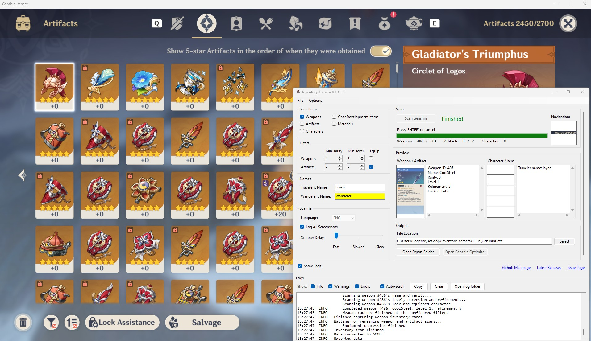

# Inventory Kamera

A fan-made Genshin Impact inventory scanner for Windows. Inventory Kamera navigates the game's menus,
reads your characters, weapons, artifacts, and materials with OCR, and exports everything in the
[GOOD](https://frzyc.github.io/genshin-optimizer/good) JSON format.

It also scans achievements by reading and scrolling their category lists with
OCR, and exports confirmed completed IDs for Paimon.moe, Seelie, and AkashaScanner.
See [Achievement scanning](docs/achievement-scanning.md) for formats and coverage checks.

The exported file works out of the box with popular tools such as
[Genshin Optimizer](https://frzyc.github.io/genshin-optimizer/#/),
[SEELIE.me](https://seelie.me/), and [Aspirine's Genshin Impact Calculator](https://genshin.aspirine.su/).

> This project is a community continuation of [Andrewthe13th's Inventory Kamera](https://github.com/Andrewthe13th/Inventory_Kamera),
> which is no longer maintained. Game data is sourced from
> [Dimbreath's AnimeGameData2](https://gitlab.com/Dimbreath/animegamedata2).

## Runtime preview

The scanner keeps its settings, progress, previews, and output controls together
in a resizable window. **Show Logs** expands the scan log below the controls;
errors open it automatically and select the Errors filter.

## Download

Download **[InventoryKamera-win-x64.zip](https://github.com/rogerioth/Inventory_Kamera/releases/latest/download/InventoryKamera-win-x64.zip)**
from the [latest release](https://github.com/rogerioth/Inventory_Kamera/releases/latest).
Choose this ready-to-run package rather than GitHub's **Source code** archives.

1. Extract the **entire ZIP** to a writable folder, such as a folder under Documents.
2. Open that folder and double-click **`Start Inventory Kamera.cmd`**.
3. If the Visual C++ runtime needs installing or updating, the launcher starts the
   bundled Microsoft-signed installer and then opens the app. Restart Windows and
   run the launcher again if the installer requests it.

The package includes the application, its DLLs, and trained OCR models; Visual Studio
is not required. Internet access is needed to obtain the lookup tables on first use
and to update game data. The scanner requests administrator permission to interact
with the game. Its executable is not code-signed, so Windows may also show a
SmartScreen warning; the included Microsoft runtime installer has its own signature.

Every merge into `master` creates a versioned release after its CI checks pass.
See [Releases and downloads](docs/releases.md) for checksums, runtime details, and
the release process.

## Requirements

| Requirement | Details |
| --- | --- |
| Operating system | Windows 10 or 11, x64 |
| Game | Genshin Impact (global or CN client) |
| Game language | English |
| Aspect ratio | 16:9 or 16:10, windowed or borderless (fullscreen not supported) |
| Runtimes | .NET Framework 4.7.2 or newer and the [Visual C++ v14 x64 runtime](https://learn.microsoft.com/en-us/cpp/windows/latest-supported-vc-redist); the launcher checks these and includes the Visual C++ installer |

The game must also meet these settings before scanning:

- **Game Language** set to *English* (`Settings → Languages`).
- **Control Type** set to *Keyboard* (`Settings → Controls`). If you rebound the inventory (`B`),
  character (`C`), or slot-1 (`1`) keys, either restore the defaults or change the keybinds in
  Inventory Kamera's options.
- HDR disabled in Windows settings if you experience scanning issues.
- Ultrawide monitors are not supported (see the
  [original explanation](https://github.com/Andrewthe13th/Inventory_Kamera/issues/40)).

## Quick start

1. Launch Genshin Impact and log in.
2. Start Inventory Kamera and pick what to scan (weapons, artifacts, characters, materials, achievements),
   plus any rarity/level filters, in the scanner options.
3. Leave the game sitting on the **Paimon menu** and click **Scan**.
4. Do not touch the mouse or keyboard while the scan runs. Press `Enter` at any time to cancel;
   you can then use **Export Scanned Data** to save what was collected so far.
5. When the scan finishes, use **Open Export Folder** to find your `.json` file and import it
   into your tool of choice.

Inventory Kamera only reads the screen and sends menu-navigation keystrokes — it never modifies the
game. See [docs/scanning-pipeline.md](docs/scanning-pipeline.md) for how that works under the hood.

## Keeping data current

Inventory Kamera validates everything it reads against per-version lookup tables in the
`inventorylists` folder. The scanner checks for a new game data version on startup and offers to
update automatically; you can also run **Options → Update Lookup Tables** manually at any time.

- Details on the automatic updater: [docs/data-updater.md](docs/data-updater.md)
- Editing the tables by hand: [docs/lookup-tables.md](docs/lookup-tables.md)

## Documentation

| Document | Contents |
| --- | --- |
| [docs/index.md](docs/index.md) | Documentation index |
| [docs/architecture.md](docs/architecture.md) | High-level architecture and component diagram |
| [docs/scanning-pipeline.md](docs/scanning-pipeline.md) | How a scan works: navigation, OCR, and export |
| [docs/achievement-scanning.md](docs/achievement-scanning.md) | Achievement scanning, compatible exports, completeness checks and regression replay |
| [docs/data-updater.md](docs/data-updater.md) | The game data updater and its sources |
| [docs/lookup-tables.md](docs/lookup-tables.md) | Lookup table formats for manual editing |
| [docs/project-structure.md](docs/project-structure.md) | Repository and solution layout |
| [docs/development.md](docs/development.md) | Building, debugging, and contributing |
| [docs/continuous-integration.md](docs/continuous-integration.md) | Windows PR builds, offline checks, and SonarCloud quality gates |
| [docs/releases.md](docs/releases.md) | Ready-to-run downloads, automatic versions, release checks, and recovery |

## Reporting issues

Please [open an issue](https://github.com/rogerioth/Inventory_Kamera/issues/new/choose) and check for
existing reports first. Scans that go wrong leave categorized screenshots in the `logging` folder —
attaching a zip of that folder is the single most useful thing you can include.
Remove the UID and other private information before sharing logs or captures.

## Contributing

Pull requests are welcome. Read [CONTRIBUTING.md](CONTRIBUTING.md) for contribution,
validation, and review requirements. See [docs/development.md](docs/development.md)
for build instructions and a tour of the codebase.

## FAQ

**Can Inventory Kamera get me banned?**
Per [HoYoverse's statement on third-party software](https://genshin.hoyoverse.com/en/news/detail/5763)
we believe not. The scanner only takes screenshots and sends menu-navigation keystrokes; it provides
no exploits, progression, or account access, and interaction is limited to menus. That said, use of
any third-party tool is at your own discretion.

**Which languages are supported?**
English only, since the OCR model is trained exclusively on the English UI.

**Where can I ask for help?**
[Open a discussion](https://github.com/rogerioth/Inventory_Kamera/discussions) or an issue on GitHub.

## License

Distributed under the [MIT license](LICENSE). Third-party libraries are distributed under their own
licenses.

---

Not affiliated with or endorsed by HoYoverse. Genshin Impact™ and related properties belong to
© Cognosphere Pte. Ltd. and miHoYo.
