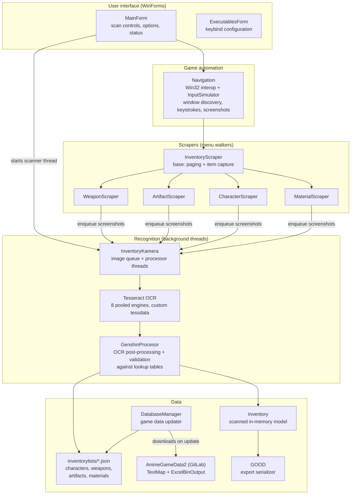
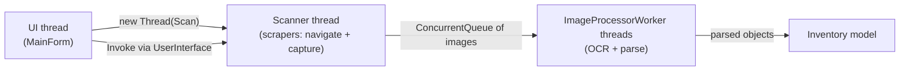

# Architecture

Inventory Kamera is a .NET Framework 4.7.2 WinForms application. It combines four concerns that are
kept in separate layers: driving the game window, reading it, understanding what was read, and
exporting the result.

## Component overview

## Layers

### User interface — `ui/`

`MainForm` owns the scan lifecycle: it validates settings, spawns the scanner thread, registers the
`Enter` stop hotkey, and relays progress to the status controls. It never talks to the game window
directly. `ExecutablesForm` manages custom keybinds. `UserInterface` is a small static helper the
scanner thread uses to marshal updates back onto the UI thread.

### Game automation — `game/Navigation.cs`

`Navigation` finds the Genshin Impact process (`GenshinImpact.exe` / `YuanShen.exe`), resolves the
client rect with `user32` interop, validates the 16:9 / 16:10 aspect ratio, and exposes everything
the scrapers need: scaled click/scroll coordinates, `InputSimulator` keystrokes, and
`CaptureWindow()` screenshots. All screen coordinates are computed relative to the detected window
size so any supported resolution works.

### Scrapers — `scraping/`

Each scraper walks one in-game menu:

- `InventoryScraper` is the shared base class: it implements inventory paging, item highlighting,
  screenshot capture, and the retry logic for misreads.
- `WeaponScraper`, `ArtifactScraper`, `CharacterScraper`, and `MaterialScraper` implement the
  menu-specific navigation and crop the relevant UI regions (name plate, level, rarity stars,
  substats, …) before enqueueing images for OCR.

Scrapers run on the scanner thread; they only capture images and never OCR them synchronously.

### Recognition — `data/InventoryKamera.cs` + `scraping/GenshinProcesor.cs`

`InventoryKamera` is the in-scan coordinator. It runs the scrapers in sequence, feeds a concurrent
image queue to a pool of `ImageProcessorWorker` threads, and collects parsed objects into
`Inventory`. OCR runs on a pool of 8 `TesseractEngine` instances using the custom-trained
`genshin_fast_09_04_21` model.

`GenshinProcesor` is the static knowledge base of the scanner: it loads the lookup tables
(see [Data updater](data-updater.md)), converts OCR output into GOOD-style names
(`Traveler's Sword` → `TravelersSword`), maps stat names to GOOD keys
(`Energy Recharge` → `enerRech_`), and validates every parsed item. Items that fail validation are
retried by the scraper; if they still fail they are logged with a screenshot in `logging/`.

### Export — `data/GOOD.cs`

After the scan, the `Inventory` model is serialized to GOOD v2 JSON (`format: "GOOD"`,
`source: "Inventory_Kamera"`) and written to the configured output folder. A `.json` per failed item
is also written under `logging/` for bug reports.

### Game data — `data/DatabaseManager.cs`

`DatabaseManager` checks the upstream game-data repository for a new version and (re)generates the
`inventorylists/*.json` lookup tables the recognizer depends on. It is fully independent from
scanning and documented in [Data updater](data-updater.md).

## Threading model

- The **scanner thread** owns game navigation. Only it sends input and takes screenshots.
- **Processor threads** own OCR. They pull from a queue, so navigation never waits on recognition.
- Results funnel into `Inventory`, which is exported on the UI thread once the scanner finishes.
- Pressing `Enter` aborts the scanner thread (`ThreadAbortException` is handled at every scraper
  boundary) and returns control to the UI.

## Data flow summary

1. Startup: `DatabaseManager` may update `inventorylists/` from AnimeGameData2.
2. `GenshinProcesor.ReloadData()` loads the lookup tables into memory.
3. The scan walks menus and turns pixels into typed objects validated against those tables.
4. The `Inventory` model is serialized to a GOOD JSON file.

More detail on steps 3–4: [Scanning pipeline](scanning-pipeline.md).
