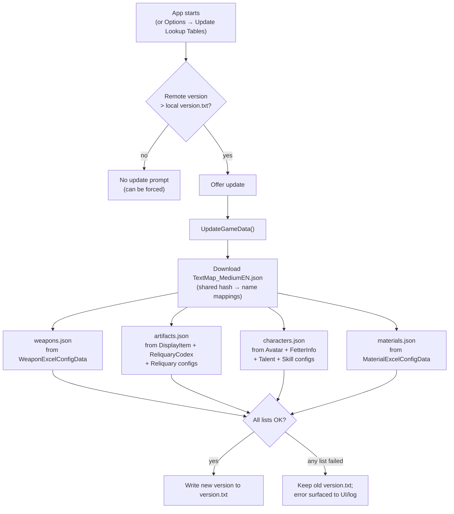

# Data updater

Inventory Kamera never hardcodes item names. Every name, set piece, element, constellation order,
and weapon type it accepts comes from four lookup tables in `inventorylists/` that are generated
from the game's raw data dumps. This document explains where that data comes from and how the
updater works. For the table file formats, see [Lookup tables](lookup-tables.md).

## Data source

All game data comes from **[Dimbreath/animegamedata2](https://gitlab.com/Dimbreath/animegamedata2)**,
a GitLab repository of extracted Genshin Impact release data (the successor to the original
`AnimeGameData` repository, which is no longer updated). Two parts of that repository are used:

| Path | Used for |
| --- | --- |
| `TextMap/TextMap_MediumEN.json` | Hash → English text mapping for every localized string |
| `ExcelBinOutput/*.json` | Structured game tables: avatars, weapons, relics, materials, talents, skills |

> **Why `TextMap_MediumEN.json` and not `TextMapEN.json`?** In the newer dumps the full
> `TextMapEN.json` is a much larger corpus whose keys no longer align one-to-one with the
> `nameTextMapHash` values referenced in `ExcelBinOutput`. The "Medium" text map is the one that
> resolves the hashes used by the excel tables.

## Version detection

The updater needs to know which game version the local tables were generated for. Commit titles in
`animegamedata2` follow the pattern `CNRELWin<major>.<minor>.<patch>_<build hashes>`
(e.g. `CNRELWin7.1.0_R48379043_S48511369_D48533839`), so the version is parsed from the commit
title with the regex `\d+\.\d+\.\d+`.

The latest commits are read from the repository's **Atom commit feed**
(`https://gitlab.com/Dimbreath/animegamedata2/-/commits/main.atom`) rather than the GitLab REST API,
because the API endpoint is protected by bot-detection that rejects non-browser clients. Raw file
downloads (`/-/raw/main/...`) are unaffected.

The detected version is stored in `inventorylists/version.txt` and compared on every startup.

## Update flow

Notes on each list:

- **Weapons** — every weapon whose name hash resolves in the text map. Unreleased weapons (hash not
  in the text map) are skipped with a warning; this is expected.
- **Artifacts** — set display items are matched through the relic codex to the five individual
  pieces, producing the set/piece structure the scanner validates against.
- **Characters** — for each `AVATAR_FORMAL` avatar: display name, element (from fetter info),
  constellation name, constellation C3 order (`skill` first or `burst` first, inferred by checking
  which talent the constellation description mentions), and weapon type. The Traveler is special-cased:
  one entry covering all elements with per-element constellation orders.
- **Materials** — the material categories the scanner reads: EXP fruit, avatar materials, exchange
  goods, wood, fish bait, and weapon enhancement stones.

## Known quirks in current dumps

These are handled by the updater but worth knowing about:

- **Some JSON keys are omitted entirely** (rather than `null`) in the newer `ExcelBinOutput` dumps —
  e.g. `skillIcon` on some skill rows. Lookups are written null-safe for this reason.
- **`WEAPON_CROSSBOW` exists only as placeholder data** (one unnamed template weapon; the Traveler
  rows are tagged with it). There is no crossbow class in-game, so the updater treats it as
  **sword** — the Traveler's actual weapon — until a real crossbow class ships. If a future game
  version adds one, `Weapon.cs` and the updater's weapon-type mapping need a new case.
- **Test avatars** (`Mannequin`/`Manekina`) are flagged `AVATAR_FORMAL` in the dumps but have no
  talents, so they fail generation and are skipped — which is the correct outcome.
- **`TextMapEN.json`** in the new repo does **not** resolve the excel hashes (see note above);
  using it yields empty results.

## Manual updates

The updater covers normal operation. If it fails (network error, upstream format change), you can
edit the JSON files by hand — the formats are documented in
[Lookup tables](lookup-tables.md). After editing, delete `version.txt` contents carefully or use
**force update** so the next check re-runs.
