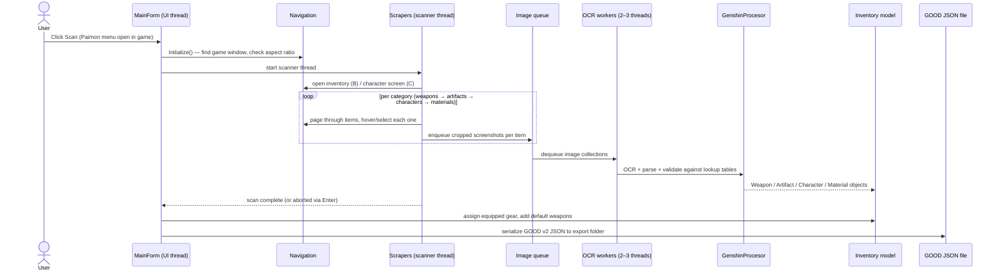

# Scanning pipeline

This document follows one scan from the **Scan** button to the exported JSON file.
Component responsibilities are covered in [Architecture](architecture.md); this page is about the
flow and the rules that keep OCR reliable.

## End-to-end flow

## Phases in detail

### 1. Pre-flight checks

Before any input is sent, the scanner:

- Resolves the game window by process name (`GenshinImpact` / `YuanShen`, configurable in
  `Properties.Settings.Default.Executables`).
- Verifies the aspect ratio is 16:9 or 16:10 and that `CaptureWindow()` returns an image matching
  the client rect (catches exclusive-fullscreen setups, which are unsupported).
- Resets the categorized `logging/` folders used for misread evidence.

### 2. Navigation and capture (scanner thread)

`InventoryScraper` implements the shared walk: open the right menu, iterate pages, select each item,
and crop regions of interest (name plate, level, rarity stars, refinement, substats, …). Each
category scraper specializes this:

| Scraper | Menu | Captures |
| --- | --- | --- |
| `WeaponScraper` | Inventory → Weapons | name, level, rarity, refinement, lock |
| `ArtifactScraper` | Inventory → Artifacts | set piece, slot, level, rarity, main stat, substats, location |
| `CharacterScraper` | Character screen | level, constellation, ascension |
| `MaterialScraper` | Inventory → character development items | item names and counts |

Scrapers never OCR synchronously — they enqueue an `OCRImageCollection` and move on. This keeps
navigation running at a steady cadence while recognition happens in parallel.

### 3. Recognition (worker threads)

`InventoryKamera.ImageProcessorWorker` threads dequeue image collections and run Tesseract with the
custom `genshin_fast_09_04_21` model. `GenshinProcesor` then:

1. **Normalizes text** — strips whitespace/punctuation, applies GOOD-style casing
   (`Sands of Eon` → `SandsofEon` → `sandsofeon`).
2. **Validates against lookup tables** — the parsed name must exist in `weapons.json`,
   `artifacts.json`, `characters.json`, or `materials.json`. This is why the tables must match your
   game version (see [Data updater](data-updater.md)).
3. **Maps controlled vocabularies** — stat names to GOOD keys (`Energy Recharge` → `enerRech_`),
   element names, artifact slots, weapon types.
4. **Emits typed objects** into the `Inventory` model, or rejects the read.

Rejected reads are retried by the scraper with a fresh screenshot; persistent failures are dumped
with their screenshots into `logging/<category>/` for bug reports.

### 4. Assembly and export

After the scrapers finish:

- Equipped weapons/artifacts are assigned to their characters
  (`InventoryKamera.AssignWeapons()` / artifact equivalents).
- Characters with no equipped weapon get their default 1-star weapon (derived from the character's
  weapon type, e.g. the Traveler's Dull Blade), matching what the game shows.
- The `GOOD` serializer writes the export file (`format: "GOOD"`, `version: 2`,
  `source: "Inventory_Kamera"`) to the configured output directory.

## Reliability rules

- **Do not touch the mouse/keyboard during a scan** — the scanner owns all input.
- **`Enter` is the global stop key.** Aborting raises `ThreadAbortException` inside the scrapers,
  which is caught per category; partial data can still be exported manually.
- **The Scanner Delay setting** slows navigation for slower machines. At delay 0 the pipeline runs
  3 OCR workers, otherwise 2.
- **Resolution changes mid-scan** invalidate every stored coordinate and will corrupt a scan —
  don't resize the window while scanning.
- **HDR and ultrawide** are unsupported; disable HDR in Windows if scans misread.
